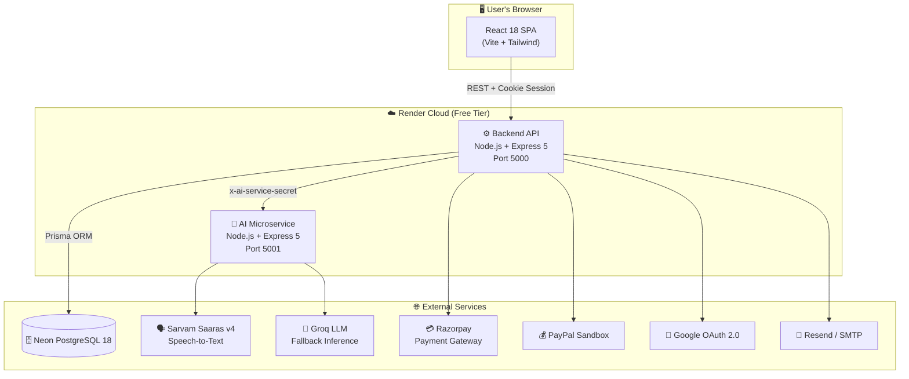
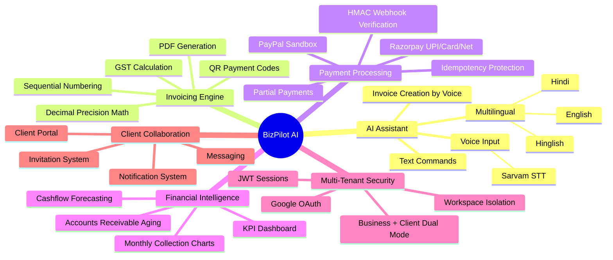
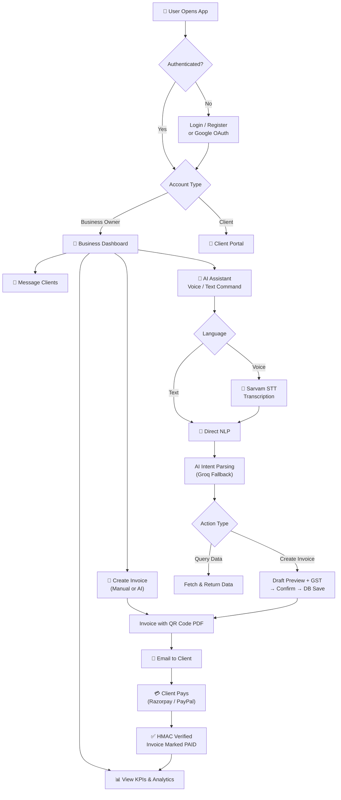
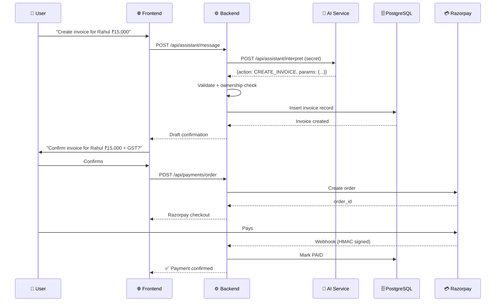
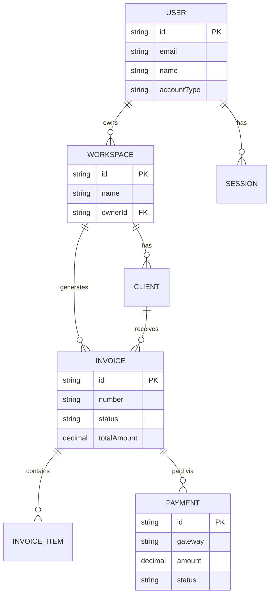
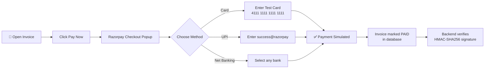

# 🚀 BizPilot AI — Intelligent Business Operations Platform

[](https://vitejs.dev)
[](https://expressjs.com)
[-4169E1)](https://neon.tech)
[](https://sarvam.ai)
[](https://razorpay.com)
[](./LICENSE)

**BizPilot AI** is a full-stack, AI-powered business management platform built for freelancers, startups, and small enterprises — combining intelligent invoicing, real-time payment tracking, multilingual AI assistance (English/Hindi/Hinglish), client collaboration portals, and financial analytics into a single cohesive product, deployed as three microservices on Render.

---

## 🔗 Live Links

| Service | URL |
|---|---|
| 🌐 **Frontend** | [https://biz-pilot-ai.onrender.com](https://biz-pilot-ai.onrender.com) |
| 🔧 **Backend API** | [https://bizpilot-ai-backend.onrender.com](https://bizpilot-ai-backend.onrender.com) |
| 🤖 **AI Service** | [https://bizpilot-ai-service.onrender.com](https://bizpilot-ai-service.onrender.com) |
| 🎥 **YouTube Demo** | [▶️ Watch Full Project Demo](https://www.youtube.com/watch?v=YOUR_VIDEO_ID) |
| 💻 **GitHub** | [github.com/aryan24cse109-dev/BizPilot-AI](https://github.com/aryan24cse109-dev/BizPilot-AI) |

> [!CAUTION]
> ## ⚠️ Important — Render Free Tier Cold Start
> This project is hosted on **Render's free tier**. Free-tier services **automatically spin down after 15 minutes of inactivity** and take **~30–60 seconds to wake up** on the next request.
>
> **Before using the app:**
> 1. Click 👉 [Backend API](https://bizpilot-ai-backend.onrender.com) — wait for it to respond
> 2. Click 👉 [AI Service](https://bizpilot-ai-service.onrender.com) — wait for it to respond
> 3. Then open 👉 [Frontend](https://biz-pilot-ai.onrender.com)
>
> After the first load, everything runs at full speed!

---

## 🏗️ Project Architecture



---

## 📦 Repository Structure

```
BizPilot-AI/
├── 🌐 frontend/          # React 18 SPA (Vite + Tailwind)
│   └── README.md         # Frontend docs
├── ⚙️ backend/           # Express 5 REST API + Prisma
│   └── README.md         # Backend docs
├── 🤖 ai-service/        # AI NLP + STT Microservice
│   └── README.md         # AI service docs
├── 🗄️ database/          # DB scripts & seed data
├── 📄 docs/              # Additional documentation
├── .env.example          # Root environment template
└── README.md             # This file
```

---

## 🎯 Key Features



---

## 🛠️ Full Tech Stack

| Layer | Technology | Version | Purpose |
|---|---|---|---|
| **Frontend** | React | 18.3.1 | UI library |
| | Vite | 6.0.7 | Build tool |
| | Tailwind CSS | 3.4.17 | Styling |
| | React Router | 7.1.1 | Routing |
| | TanStack Query | 5.62.8 | Server state |
| | Recharts | 2.15.0 | Data visualization |
| | Axios | 1.7.9 | HTTP client |
| | React Hook Form | 7.54.2 | Forms |
| | Zod | 3.24.2 | Validation |
| **Backend** | Node.js | LTS | Runtime |
| | Express | 5.3.0 | HTTP framework |
| | Prisma | 7.9.1 | ORM |
| | PostgreSQL | 18 (Neon) | Database |
| | JWT | 9.0.3 | Auth tokens |
| | PDFKit | 0.20.2 | PDF generation |
| | Decimal.js | 10.6.0 | Exact arithmetic |
| | Razorpay | HTTP API | Payments |
| | Google Auth | 11.3.3 | OAuth |
| **AI Service** | Sarvam Saaras v4 | API | Speech-to-Text |
| | Groq | API | LLM inference |
| | Zod | 4.6.7 | Schema validation |
| **Database** | Neon PostgreSQL | 18 | Cloud database |
| **Hosting** | Render | Free Tier | Cloud deployment |

---

## 🔄 End-to-End User Flow



---

## 🌐 Service Communication Map



---

## 📊 Feature Comparison Table

| Feature | Business Owner | Client |
|---|---|---|
| Dashboard & KPIs | ✅ Full access | ❌ |
| Create Invoices | ✅ | ❌ |
| View Invoices | ✅ All invoices | ✅ Own invoices only |
| Make Payments | ❌ | ✅ |
| AI Assistant | ✅ | ❌ |
| Analytics | ✅ | ❌ |
| Messaging | ✅ | ✅ |
| Client Management | ✅ | ❌ |
| Settings | ✅ | ✅ |
| Download PDF | ✅ | ✅ |

---

## 🗄️ Database Overview



---

## 💳 Payments — Razorpay Integration

BizPilot AI uses **Razorpay** as its primary payment gateway for processing invoices.

### How it works in the Demo

Since this is a demo/sandbox environment, **no real money is charged**. Use the Razorpay test credentials below to simulate payments:

| Field | Value |
|---|---|
| 💳 **Test Card Number** | `4111 1111 1111 1111` |
| 📅 **Expiry** | Any future date (e.g. `12/26`) |
| 🔐 **CVV** | Any 3 digits (e.g. `123`) |
| 📱 **Test UPI ID** | `success@razorpay` |
| 🏦 **Net Banking** | Select any bank → auto success |

> [!IMPORTANT]
> **This is Razorpay Sandbox mode.** All payments in the demo are simulated — no real transactions occur. The payment flow is 100% functional but uses Razorpay's test environment.

### Razorpay Demo Payment Flow



### Supported Payment Methods (Sandbox)

| Method | Test Value | Result |
|---|---|---|
| Credit/Debit Card | `4111 1111 1111 1111` | ✅ Success |
| UPI | `success@razorpay` | ✅ Success |
| UPI (failure test) | `failure@razorpay` | ❌ Failure |
| Net Banking | Any bank | ✅ Success |
| Wallet | Any wallet | ✅ Success |

---

## 🚀 Getting Started (Local Development)

### Prerequisites
- Node.js 20+
- npm 10+
- PostgreSQL (or Neon account)

### 1. Clone & Install
```bash
git clone https://github.com/aryan24cse109-dev/BizPilot-AI.git
cd BizPilot-AI
```

### 2. Setup Backend
```bash
cd backend
npm install
cp .env.example .env     # Fill in your keys
npx prisma generate
npx prisma migrate dev
npm run dev              # http://localhost:5000
```

### 3. Setup AI Service
```bash
cd ai-service
npm install
cp .env.example .env     # Set AI_SERVICE_SECRET, SARVAM_API_KEY, GROQ_API_KEY
npm run dev              # http://localhost:5001
```

### 4. Setup Frontend
```bash
cd frontend
npm install
cp .env.example .env     # Set VITE_API_URL=http://localhost:5000
npm run dev              # http://localhost:5173
```

---

## 🔐 Demo Test Accounts

| Role | Email | Password | Entity |
|---|---|---|---|
| 🏢 Business Owner | `business@bizpilot.ai` | `Password@123` | TechNova Solutions |
| 👥 Client | `rahul@rahulenterprises.com` | `Password@123` | Rahul Enterprises |

---

## 🧪 Running Tests

```bash
# Backend tests (auth, invoice, payment, AI)
cd backend && npm test

# AI service tests
cd ai-service && npm test && npm run check
```

---

## 📂 Sub-READMEs

Each service has its own detailed documentation:

| Service | README |
|---|---|
| 🌐 Frontend | [frontend/README.md](./frontend/README.md) |
| ⚙️ Backend | [backend/README.md](./backend/README.md) |
| 🤖 AI Service | [ai-service/README.md](./ai-service/README.md) |

---

## ©️ Ownership & License

> **IMPORTANT NOTICE:**
> The right to this project is owned by **DEVRATOR**. All rights reserved.
> Unauthorized reproduction, distribution, or use of this codebase is prohibited.
