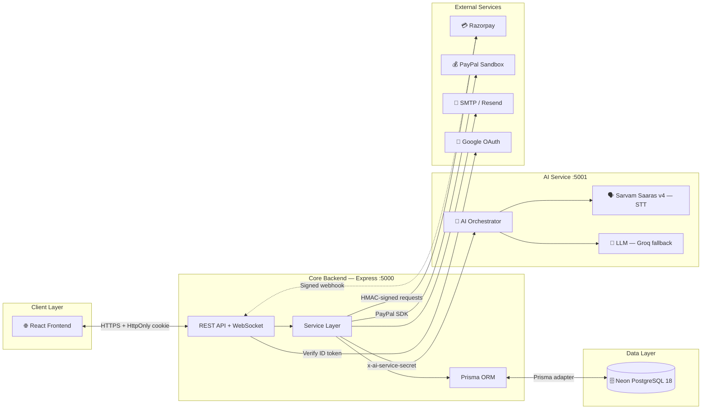
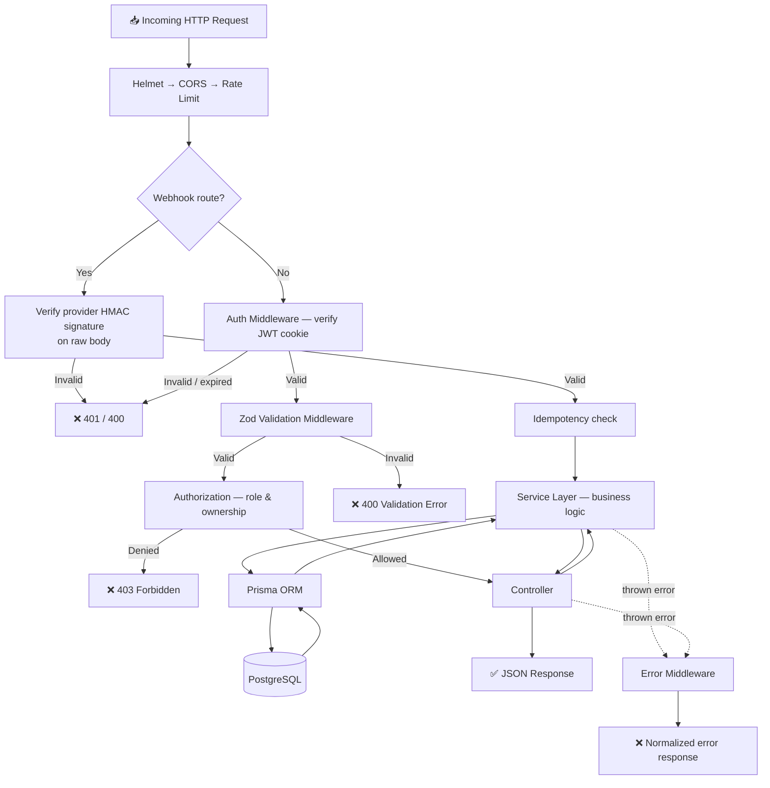
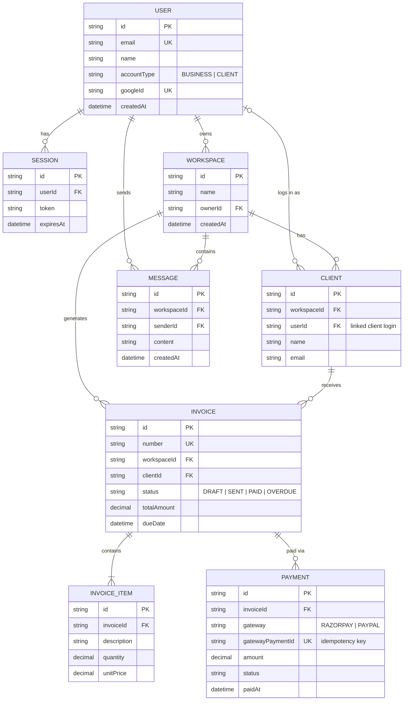
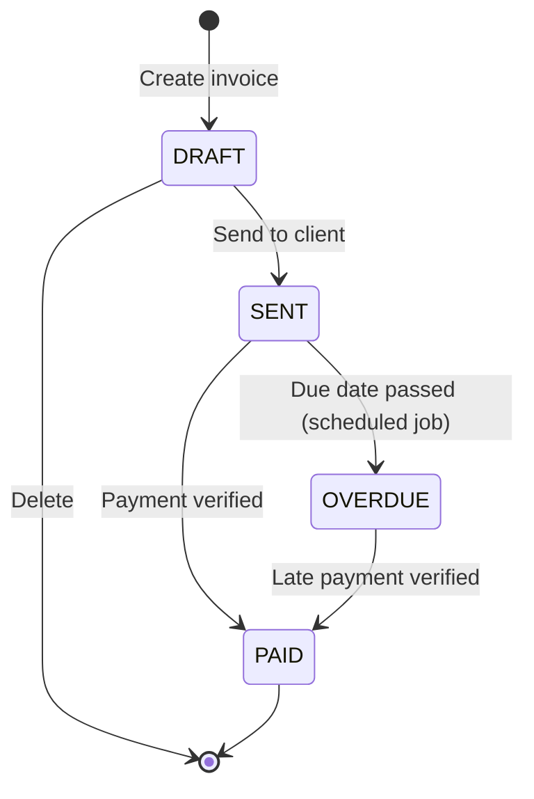
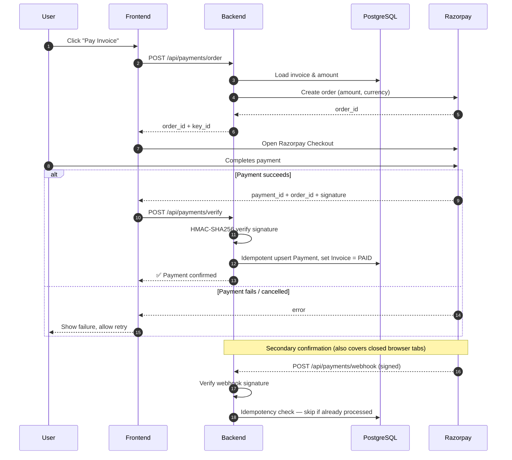
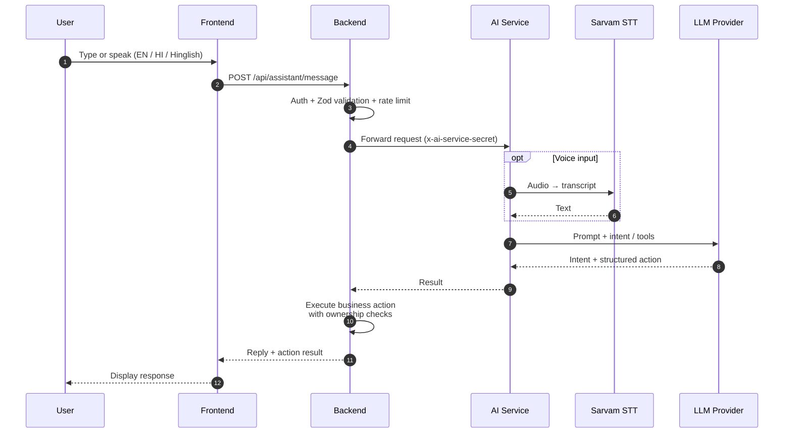

# ⚙️ BizPilot AI — Backend


> **REST API for BizPilot AI** — invoicing, payments, client collaboration, financial reporting, and a multilingual (English / Hindi / Hinglish) AI assistant. Built by **Wealthra AI**.

BizPilot AI helps freelancers, startups, and agencies run their business operations. This backend is the **authoritative service** for all business logic, database operations, payment processing, and AI workflow execution.

---

## 📑 Table of Contents

- [Live Links](#-live-links)
- [Features](#-features)
- [Tech Stack](#️-tech-stack)
- [System Architecture](#️-system-architecture)
- [Request Lifecycle](#-request-lifecycle)
- [Folder Structure](#-folder-structure)
- [Database Schema](#️-database-schema)
- [API Endpoints](#-api-endpoints)
- [Payment Flow](#-payment-flow)
- [AI Assistant Flow](#-ai-assistant-flow)
- [Razorpay Sandbox Setup](#-razorpay--sandbox-setup--test-credentials)
- [Security](#-security)
- [Local Setup](#-local-setup)
- [Environment Variables](#-environment-variables)
- [Testing](#-testing)
- [Demo Credentials](#-demo-credentials)
- [Ownership](#️-ownership)

---

## 🔗 Live Links

| Service | URL |
|---|---|
| 🔧 **Backend API (Live)** | [bizpilot-ai-backend.onrender.com](https://bizpilot-ai-backend.onrender.com) |
| 🌐 **Frontend** | [biz-pilot-ai.onrender.com](https://biz-pilot-ai.onrender.com) |
| 🤖 **AI Service** | [bizpilot-ai-service.onrender.com](https://bizpilot-ai-service.onrender.com) |
| 🎥 **YouTube Demo** | [Watch Full Project Demo](https://youtu.be/mG45OiztM1I) <!-- TODO: replace YOUR_VIDEO_ID with the real video ID --> |
| 💻 **GitHub** | [github.com/aryan24cse109-dev/BizPilot-AI](https://github.com/aryan24cse109-dev/BizPilot-AI) |

> [!CAUTION]
> **Render Free Tier — Cold Start Warning**
> The services spin down after **15 minutes of inactivity**. If the API is unresponsive on first hit, open the backend link above to wake it up. The first response may take **~30–60 seconds**; later requests are fast.
> Wake the **backend and AI service** both before a demo.

---

## ✨ Features

- 🧾 **Invoicing** — create, update, track and download invoices as PDF (with payment QR codes)
- 💳 **Payments** — Razorpay (UPI, Card, NetBanking, Wallet) with signature verification, webhooks and idempotency; PayPal adapter available
- 🤖 **AI assistant** — text and voice, understands English, Hindi and Hinglish
- 👥 **Clients & workspaces** — multi-workspace model with role / ownership enforcement
- 💬 **Messaging** — client ↔ business collaboration (REST + WebSockets)
- 📊 **Dashboard** — KPIs, monthly cash flow, accounts-receivable aging
- 🔐 **Auth** — email/password and Google OAuth, JWT in HTTP cookies
- 📧 **Email** — transactional emails via SMTP or Resend

---

## 🛠️ Tech Stack

| Layer | Technology | Version | Purpose |
|---|---|---|---|
| Runtime | Node.js | LTS | JavaScript runtime |
| Framework | Express | 5.3.0 | HTTP framework (ES modules) |
| ORM | Prisma | 7.9.1 | ORM & migrations |
| Database | PostgreSQL (Neon) | 18 | Primary database |
| Validation | Zod | 4.6.7 | Request validation |
| Auth | JWT | 9.0.3 | Session tokens |
| Auth | Google Auth Library | 11.3.3 | Google OAuth login |
| Security | Helmet | 8.3.0 | HTTP security headers |
| Documents | PDFKit | 0.20.2 | Invoice PDF generation |
| Documents | QRCode | 1.5.4 | Payment QR codes |
| Money | Decimal.js | 10.6.0 | Exact monetary arithmetic |
| Payments | Razorpay | HTTP API | UPI, Card, NetBanking |
| Payments | PayPal | SDK (Sandbox) | Alternate gateway |

---

## 🏗️ System Architecture



---

## 🔀 Request Lifecycle



---

## 📁 Folder Structure

```
backend/
├── prisma/
│   ├── schema.prisma           # Full database schema
│   └── migrations/             # Versioned DB migrations
│
├── src/
│   ├── app.js                  # Express middleware & route mounting
│   ├── server.js               # DB connection & HTTP lifecycle
│   │
│   ├── config/
│   │   ├── database.js         # Prisma client init
│   │   ├── env.js              # Environment variable validation
│   │   ├── ai.js               # AI service config
│   │   ├── email.js            # Email adapter config
│   │   ├── google.js           # Google OAuth config
│   │   └── razorpay.js         # Razorpay config
│   │
│   ├── middleware/
│   │   ├── auth.middleware.js      # JWT session verification
│   │   ├── authz.middleware.js     # Role/ownership enforcement
│   │   ├── validate.middleware.js  # Zod request validation
│   │   ├── rateLimit.middleware.js
│   │   └── error.middleware.js
│   │
│   ├── controllers/            # Route handlers
│   │   ├── auth.controller.js
│   │   ├── ai.controller.js
│   │   ├── invoice.controller.js
│   │   ├── payment.controller.js
│   │   ├── client.controller.js
│   │   ├── dashboard.controller.js
│   │   ├── message.controller.js
│   │   └── workspace.controller.js
│   │
│   ├── integrations/
│   │   ├── ai/                 # Backend → AI service HTTP client
│   │   │   ├── ai.client.js
│   │   │   ├── gemini.provider.js
│   │   │   └── sarvam.provider.js
│   │   ├── email/
│   │   │   ├── email.service.js
│   │   │   └── email.templates.js
│   │   ├── payments/
│   │   │   ├── adapter.js          # Payment gateway abstraction
│   │   │   ├── razorpay.adapter.js
│   │   │   └── paypal.adapter.js
│   │   └── razorpay/
│   │       ├── razorpay.service.js
│   │       ├── razorpay.signature.js
│   │       └── razorpay.webhook.js
│   │
│   ├── modules/                # Domain-driven route/service modules
│   ├── services/               # Business logic services
│   ├── routes/                 # Express router definitions
│   ├── validators/             # Zod schemas per domain
│   ├── jobs/                   # Background/scheduled jobs
│   ├── sockets/                # WebSocket handlers
│   └── utils/                  # Helpers & shared utilities
│
└── tests/
    ├── auth.test.js
    ├── invoice.test.js
    ├── payment.test.js
    └── ai.test.js
```

---

## 🗄️ Database Schema



> 📝 The `status` values, `gatewayPaymentId`, and `MESSAGE` entity above reflect the intended design — keep them in sync with `prisma/schema.prisma`.

### Invoice Status Lifecycle



---

## 📡 API Endpoints

Base URL: `https://bizpilot-ai-backend.onrender.com` (local: `http://localhost:5000`)

All endpoints except `register`, `login`, `google`, `forgot-password`, and the payment webhook require a valid session cookie.

### Authentication
| Method | Endpoint | Description |
|---|---|---|
| POST | `/api/auth/register` | Register new user |
| POST | `/api/auth/login` | Email/password login |
| POST | `/api/auth/google` | Google OAuth login |
| POST | `/api/auth/logout` | Invalidate session |
| GET | `/api/auth/me` | Current user info |
| POST | `/api/auth/forgot-password` | Password reset |

### Invoices
| Method | Endpoint | Description |
|---|---|---|
| GET | `/api/invoices` | List workspace invoices |
| POST | `/api/invoices` | Create invoice |
| GET | `/api/invoices/:id` | Invoice details |
| PATCH | `/api/invoices/:id` | Update invoice |
| DELETE | `/api/invoices/:id` | Delete invoice |
| GET | `/api/invoices/:id/pdf` | Download PDF |

### Payments
| Method | Endpoint | Auth | Description |
|---|---|---|---|
| POST | `/api/payments/order` | Cookie | Create Razorpay order |
| POST | `/api/payments/verify` | Cookie | Verify payment signature |
| POST | `/api/payments/webhook` | HMAC signature | Razorpay webhook |
| GET | `/api/payments` | Cookie | Payment history |

### AI Assistant
| Method | Endpoint | Description |
|---|---|---|
| POST | `/api/assistant/message` | Chat with AI (text/voice) |

### Dashboard
| Method | Endpoint | Description |
|---|---|---|
| GET | `/api/dashboard/stats` | KPI summary |
| GET | `/api/dashboard/cashflow` | Monthly collection chart data |
| GET | `/api/dashboard/aging` | Accounts receivable aging |

<!-- TODO: document Clients, Workspaces and Messages endpoints (controllers exist: client, workspace, message). -->

### Error Format

```json
{
  "success": false,
  "error": {
    "code": "VALIDATION_ERROR",
    "message": "Invalid request body"
  }
}
```

| Status | Meaning |
|---|---|
| `400` | Zod validation failed |
| `401` | Missing / invalid / expired session |
| `403` | Authenticated but not allowed (role / ownership) |
| `404` | Resource not found |
| `429` | Rate limit exceeded |
| `500` | Unexpected server error |

> 📝 Adjust the error JSON above to match what `error.middleware.js` actually returns.

---

## 💳 Payment Flow



---

## 🤖 AI Assistant Flow



> 📝 The AI service never touches the database directly — the backend executes every action after authorization checks.

---

## 💳 Razorpay — Sandbox Setup & Test Credentials

BizPilot AI uses **Razorpay** as its primary payment gateway. The demo runs in **Sandbox mode** — the full flow works, no real money is charged.

### Test Credentials for Demo

| Method | Test Value | Expected Result |
|---|---|---|
| 💳 Card | `4111 1111 1111 1111` | ✅ Payment success |
| 📅 Expiry | Any future date | — |
| 🔐 CVV | Any 3 digits | — |
| 📱 UPI (success) | `success@razorpay` | ✅ Payment success |
| 📱 UPI (failure) | `failure@razorpay` | ❌ Payment failed |
| 🏦 Net Banking | Any bank | ✅ Payment success |
| 👛 Wallet | Any wallet | ✅ Payment success |

### What happens after a Razorpay payment

1. Frontend receives `payment_id`, `order_id`, `signature` from Razorpay
2. Backend verifies the **HMAC-SHA256 signature** — tampered responses are rejected
3. Idempotency check prevents double-processing on duplicate webhooks
4. Invoice status is updated to `PAID` in PostgreSQL
5. Razorpay also fires a **signed webhook** as secondary confirmation

> [!IMPORTANT]
> Never use real card numbers in sandbox mode. `4111 1111 1111 1111` is a widely used test card that always succeeds in sandbox.

---

## 🔒 Security

| Area | Measure |
|---|---|
| Transport / headers | Helmet security headers, CORS allow-list |
| Abuse protection | Rate limiting middleware |
| Input | Zod validation on every request body, query and params |
| Sessions | JWT in cookies, verified on each request, stored sessions can be invalidated on logout |
| Access control | Role + ownership checks (`authz.middleware.js`) — users only reach their own workspace data |
| Payments | HMAC-SHA256 signature verification, signed webhooks, idempotent processing |
| Money | `Decimal.js` — no floating-point errors |
| Service-to-service | AI service protected by shared secret header (`x-ai-service-secret`) |
| Secrets | All via environment variables, validated at startup (`config/env.js`) |

> [!WARNING]
> Demo credentials and sandbox keys are for **demonstration only**. Never reuse them, or commit real secrets, in production.

---

## 🚀 Local Setup

**Prerequisites:** Node.js (LTS), a PostgreSQL database (local or [Neon](https://neon.tech)), and Razorpay test keys.

```bash
git clone https://github.com/aryan24cse109-dev/BizPilot-AI.git
cd BizPilot-AI/backend

npm install
cp .env.example .env     # Fill in DB, JWT, Razorpay, Google, AI keys

# Database
npx prisma generate
npx prisma migrate dev

# Start dev server
npm run dev              # http://localhost:5000
```

### Available Scripts
| Script | Command | Description |
|---|---|---|
| Dev Server | `npm run dev` | Nodemon auto-reload |
| Production | `npm start` | Node server |
| DB Migrate | `npm run db:migrate` | Run Prisma migrations |
| DB Studio | `npm run db:studio` | GUI for DB |
| Tests | `npm test` | Run all test suites |

---

## 🔑 Environment Variables

Copy `.env.example` to `.env`. Typical variables:

| Variable | Description |
|---|---|
| `DATABASE_URL` | PostgreSQL connection string |
| `JWT_SECRET` | Secret for signing session tokens |
| `FRONTEND_URL` | Allowed CORS origin |
| `RAZORPAY_KEY_ID` / `RAZORPAY_KEY_SECRET` | Razorpay API credentials |
| `RAZORPAY_WEBHOOK_SECRET` | Verifies incoming webhooks |
| `GOOGLE_CLIENT_ID` | Google OAuth |
| `AI_SERVICE_URL` / `AI_SERVICE_SECRET` | AI service endpoint and shared secret |
| `SMTP_*` / `RESEND_API_KEY` | Email delivery |

> 📝 Variable names are indicative — `src/config/env.js` is the source of truth.

---

## 🧪 Testing

```bash
npm test
```

Suites: `auth`, `invoice`, `payment`, `ai` (in `tests/`).

---

## 🔐 Demo Credentials

| Role | Email | Password |
|---|---|---|
| Business Owner | `business@bizpilot.ai` | `Password@123` |
| Client | `rahul@rahulenterprises.com` | `Password@123` |

> These accounts exist only for the sandbox demo.

---

## ©️ Ownership

> All rights reserved. This project is owned by **Wealthra AI**.
