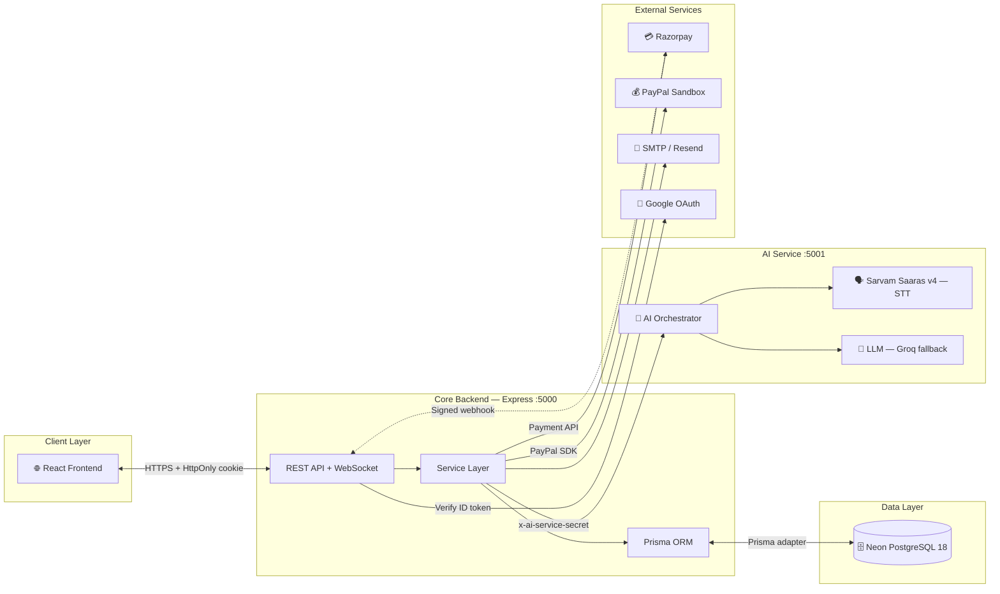
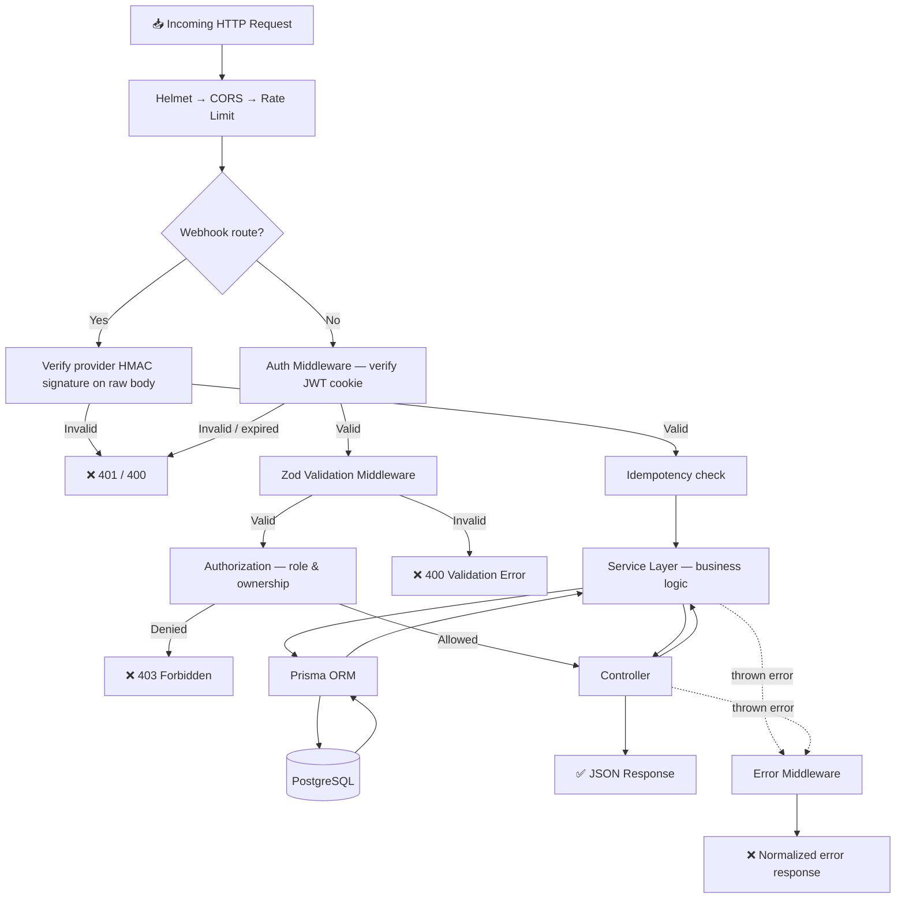
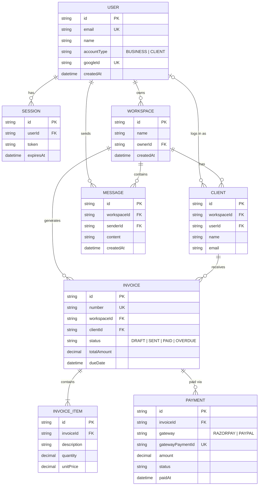
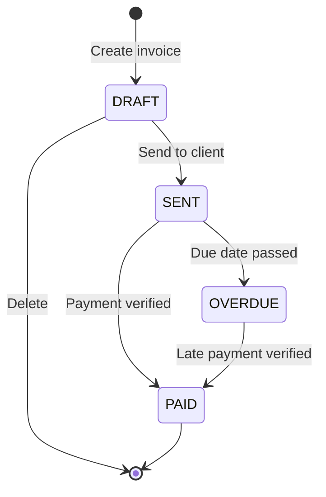
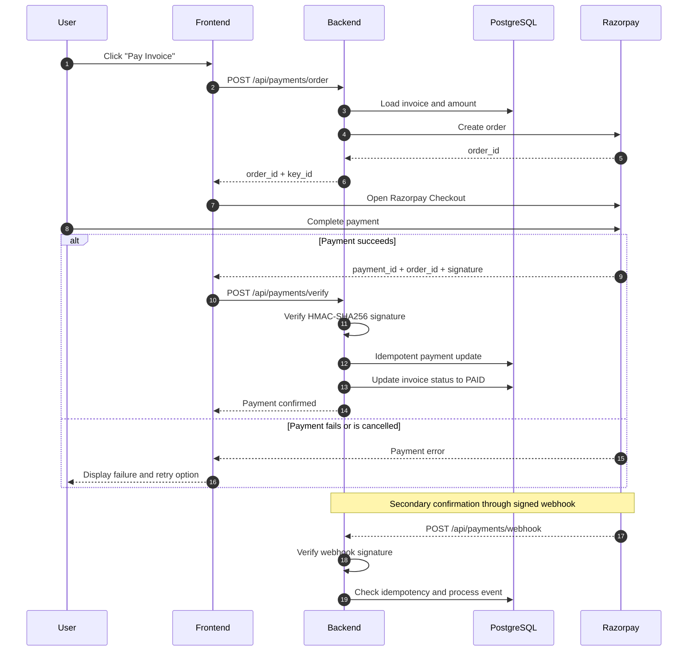
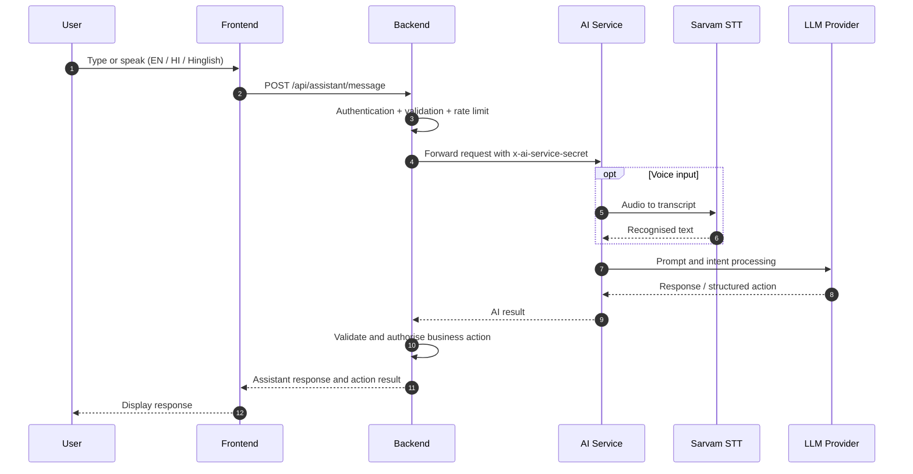

# ⚙️ Wealthra AI 


> **The backend powering Wealthra AI** — a business management platform for freelancers, startups, and agencies, bringing together invoicing, payments, client collaboration, financial reporting, and a multilingual AI assistant.

Wealthra AI helps businesses manage their day-to-day operations through a unified workspace. This backend is the authoritative service for business logic, database operations, payment processing, authentication, authorization, and AI workflow execution.

> [!TIP]
> ### 🏆 Flip the Switch Hackathon Documentation
>
> For hackathon-specific agent configuration, channel setup, and integration instructions, see **[SWITCH_README.md](./SWITCH_README.md)**.
>
> It includes:
> - 🤖 **Connected Agents:** Multilingual Voice Agent (Sarvam), Operations/Invoicing Agent (Groq), and Payment/Audit Agent (Razorpay).
> - 💬 **Channel Setup:** `#ops-assistant`, `#invoice-approvals`, and `#payment-feed`.
> - 🚀 **Integration Guide:** Setup instructions and the hackathon integration walkthrough.

---

## 📑 Table of Contents

- [Live Links](#-live-deployments--health-endpoints)
- [Features](#-features)
- [Tech Stack](#️-tech-stack)
- [System Architecture](#️-system-architecture)
- [Request Lifecycle](#-request-lifecycle)
- [Folder Structure](#-folder-structure)
- [Database Schema](#️-database-schema)
- [API Endpoints](#-api-endpoints)
- [Payment Flow](#-payment-flow)
- [AI Assistant Flow](#-ai-assistant-flow)
- [Razorpay Sandbox Setup](#-razorpay--sandbox-setup--test-credentials)
- [Security](#-security)
- [Local Setup](#-local-setup)
- [Environment Variables](#-environment-variables)
- [Testing](#-testing)
- [Demo Credentials](#-demo-credentials)
- [Ownership](#️-ownership)

---

## 🔗 Live Deployments & Health Endpoints

| Component | Environment | Live URL | Health / Readiness Endpoint |
|---|---|---|---|
| 🌐 **Frontend** | Vercel Production | [wealthra-ai.vercel.app](https://wealthra-ai.vercel.app/) | — |
| ⚙️ **Backend API** | Render (Free Tier) | [Backend Service](https://bizpilot-ai-1-o2e5.onrender.com) | [GET /api/health](https://bizpilot-ai-1-o2e5.onrender.com/api/health) |
| 🤖 **AI Microservice** | Render (Free Tier) | [AI Service](https://bizpilot-ai-cx0e5.onrender.com) | [GET /api/health](https://bizpilot-ai-cx0e5.onrender.com/api/health) |
| 🤖 **AI Readiness** | Render (Free Tier) | — | [GET /api/health/ready](https://bizpilot-ai-cx0e5.onrender.com/api/health/ready) |
| 🎥 **Video Walkthrough** | YouTube | [Watch Demo](https://youtu.be/mG45OiztM1I) | — |
| 💻 **Source Repository** | GitHub | [Wealthra AI](https://github.com/aryan24cse109-dev/Wealthra-ai) | — |

> [!IMPORTANT]
> ### ⚡ Service Warm-Up — Render Free Tier
>
> The backend API and AI microservice are deployed on Render's free-tier hosting. Services may enter an idle state after inactivity and can take some time to respond to the first request.
>
> Before starting a demonstration:
>
> 1. **Wake up the backend:** Open the [Backend Health Check](https://bizpilot-ai-1-o2e5.onrender.com/api/health) and wait for a successful response.
> 2. **Wake up the AI service:** Open the [AI Service Health Check](https://bizpilot-ai-cx0e5.onrender.com/api/health) and, if required, the [AI Readiness Endpoint](https://bizpilot-ai-cx0e5.onrender.com/api/health/ready).
> 3. **Launch Wealthra AI:** Open the [frontend application](https://wealthra-ai.vercel.app/).
>
> Initial requests may take longer while the services start. Actual response time depends on hosting availability.

---

## ✨ Features

Wealthra AI brings business operations and client collaboration together through the following capabilities.

### 🧾 Invoicing
- Create, update, and manage business invoices.
- Track invoice lifecycle and payment status.
- Generate downloadable PDF invoices.
- Include payment QR codes in invoices.
- Associate invoices with connected clients and workspaces.

### 💳 Payments
- Razorpay integration supporting UPI, cards, net banking, and wallets.
- Payment signature verification.
- Signed payment webhook processing.
- Idempotent payment processing to prevent duplicate handling.
- PayPal payment adapter available for alternate gateway integration.

### 🤖 Multilingual AI Assistant
- Text-based and voice-based interactions.
- English, Hindi, and Hinglish support.
- Sarvam-powered speech-to-text integration.
- LLM-powered assistant workflows.
- Business-operation and invoicing assistance.

### 👥 Clients and Workspaces
- Multi-workspace business model.
- Business and client account types.
- Client-to-business connections.
- Role-based access and ownership enforcement.
- Workspace-scoped business operations.

### 💬 Messaging
- Business-to-client communication.
- REST API and WebSocket-based messaging support.
- Workspace-associated communication.

### 📊 Financial Dashboard
- Business KPI summaries.
- Monthly cash-flow information.
- Accounts-receivable aging.
- Invoice and payment information.

### 🔐 Authentication
- Email/password registration and login.
- Google OAuth authentication.
- JWT-based sessions stored in HTTP-only cookies.
- Session verification and invalidation.

### 📧 Email Notifications
- Transactional email support.
- SMTP integration.
- Resend integration.
- Email templates for application workflows.

---

## 🛠️ Tech Stack

| Layer | Technology | Version | Purpose |
|---|---|---|---|
| Runtime | Node.js | LTS | JavaScript runtime |
| Framework | Express | 5.3.0 | HTTP framework using ES modules |
| ORM | Prisma | 7.9.1 | Database access and migrations |
| Database | PostgreSQL (Neon) | 18 | Primary database |
| Validation | Zod | 4.6.7 | Request validation |
| Authentication | JWT | 9.0.3 | Session tokens |
| OAuth | Google Auth Library | 11.3.3 | Google login |
| Security | Helmet | 8.3.0 | HTTP security headers |
| Documents | PDFKit | 0.20.2 | Invoice PDF generation |
| Documents | QRCode | 1.5.4 | Payment QR generation |
| Monetary calculations | Decimal.js | 10.6.0 | Exact monetary arithmetic |
| Payments | Razorpay | HTTP API | Payment gateway integration |
| Payments | PayPal | SDK (Sandbox) | Alternate payment gateway |

### AI Service and Integrations

| Technology / Provider | Purpose |
|---|---|
| Sarvam AI | Speech-related AI integration |
| Sarvam Saaras v4 | Speech-to-text |
| Groq | LLM inference and assistant workflows |
| Gemini | AI provider integration |
| SMTP / Resend | Transactional email |
| Google OAuth | User authentication |

The exact active provider and fallback behaviour depend on the environment configuration.

---

## 🏗️ System Architecture

Wealthra AI follows a service-oriented architecture with a React frontend, an Express backend, a separate AI microservice, and PostgreSQL.



### Component Responsibilities

| Component | Responsibility |
|---|---|
| React Frontend | User interface, dashboards, invoices, client interactions |
| Express Backend | Authentication, authorization, API routes, and business logic |
| Service Layer | Invoice, payment, dashboard, AI, and client workflows |
| Prisma ORM | Database queries and migrations |
| PostgreSQL | Persistent application data |
| AI Microservice | AI orchestration, speech processing, and LLM interaction |
| Razorpay | Primary payment gateway |
| PayPal | Alternate payment gateway adapter |
| Email Providers | Transactional email delivery |
| Google OAuth | Google identity verification |

---

## 🔀 Request Lifecycle

Incoming API requests pass through middleware, validation, authorization, and the service layer before database operations are performed.



### Request Processing Steps

1. Incoming requests pass through configured security headers, CORS, and rate-limiting middleware.
2. Webhook requests are processed through their signature-verification path.
3. Other protected requests pass through authentication middleware.
4. Zod validates request bodies, parameters, and query values.
5. Authorization middleware checks roles and resource ownership.
6. Controllers pass validated operations to the service layer.
7. Services execute business logic and interact with PostgreSQL through Prisma.
8. The response is returned in JSON format.
9. Errors are handled by centralized error middleware.

---

## 📁 Folder Structure

The backend repository is organised around configuration, middleware, controllers, integrations, domain modules, services, and tests.

```text
backend/
├── prisma/
│   ├── schema.prisma
│   └── migrations/
│
├── src/
│   ├── app.js
│   ├── server.js
│   │
│   ├── config/
│   │   ├── database.js
│   │   ├── env.js
│   │   ├── ai.js
│   │   ├── email.js
│   │   ├── google.js
│   │   └── razorpay.js
│   │
│   ├── middleware/
│   │   ├── auth.middleware.js
│   │   ├── authz.middleware.js
│   │   ├── validate.middleware.js
│   │   ├── rateLimit.middleware.js
│   │   └── error.middleware.js
│   │
│   ├── controllers/
│   │   ├── auth.controller.js
│   │   ├── ai.controller.js
│   │   ├── invoice.controller.js
│   │   ├── payment.controller.js
│   │   ├── client.controller.js
│   │   ├── dashboard.controller.js
│   │   ├── message.controller.js
│   │   └── workspace.controller.js
│   │
│   ├── integrations/
│   │   ├── ai/
│   │   │   ├── ai.client.js
│   │   │   ├── gemini.provider.js
│   │   │   └── sarvam.provider.js
│   │   ├── email/
│   │   │   ├── email.service.js
│   │   │   └── email.templates.js
│   │   ├── payments/
│   │   │   ├── adapter.js
│   │   │   ├── razorpay.adapter.js
│   │   │   └── paypal.adapter.js
│   │   └── razorpay/
│   │       ├── razorpay.service.js
│   │       ├── razorpay.signature.js
│   │       └── razorpay.webhook.js
│   │
│   ├── modules/
│   ├── services/
│   ├── routes/
│   ├── validators/
│   ├── jobs/
│   ├── sockets/
│   └── utils/
│
└── tests/
    ├── auth.test.js
    ├── invoice.test.js
    ├── payment.test.js
    └── ai.test.js
```

### Important Directories

| Directory | Responsibility |
|---|---|
| `config/` | Environment, database, OAuth, AI, email, and payment configuration |
| `middleware/` | Authentication, authorization, validation, rate limits, and errors |
| `controllers/` | HTTP request handlers |
| `integrations/` | External provider integrations |
| `modules/` | Domain-oriented application modules |
| `services/` | Core business logic |
| `routes/` | Express route definitions |
| `validators/` | Zod validation schemas |
| `jobs/` | Background and scheduled jobs |
| `sockets/` | WebSocket event handling |
| `tests/` | Backend test suites |

---

## 🗄️ Database Schema

Wealthra AI uses PostgreSQL as its primary relational database and Prisma ORM for database access and migrations.

The following diagram represents the documented application data model.



> **Schema reference:** The actual Prisma schema at `backend/prisma/schema.prisma` is the authoritative source for field names, constraints, relationships, and status values. The diagram is a high-level representation and should be kept synchronized with that file.

### Invoice Status Lifecycle



An invoice moves to `PAID` only after the payment confirmation workflow succeeds.

---

## 📡 API Endpoints

### Base URL

**Production**

```text
https://bizpilot-ai-1-o2e5.onrender.com
```

**Local**

```text
http://localhost:5000
```

The production hostname is retained because it is the currently configured backend deployment URL. The application and project identity are Wealthra AI.

### Authentication

| Method | Endpoint | Description |
|---|---|---|
| POST | `/api/auth/register` | Register a new user |
| POST | `/api/auth/login` | Email/password login |
| POST | `/api/auth/google` | Google OAuth login |
| POST | `/api/auth/logout` | Invalidate the current session |
| GET | `/api/auth/me` | Retrieve current user information |
| POST | `/api/auth/forgot-password` | Password reset |

### Invoices

| Method | Endpoint | Description |
|---|---|---|
| GET | `/api/invoices` | List workspace invoices |
| POST | `/api/invoices` | Create an invoice |
| GET | `/api/invoices/:id` | Retrieve invoice details |
| PATCH | `/api/invoices/:id` | Update an invoice |
| DELETE | `/api/invoices/:id` | Delete an invoice |
| GET | `/api/invoices/:id/pdf` | Download invoice PDF |

### Payments

| Method | Endpoint | Authentication | Description |
|---|---|---|---|
| POST | `/api/payments/order` | Session cookie | Create Razorpay order |
| POST | `/api/payments/verify` | Session cookie | Verify payment signature |
| POST | `/api/payments/webhook` | HMAC signature | Process Razorpay webhook |
| GET | `/api/payments` | Session cookie | Retrieve payment history |

### AI Assistant

| Method | Endpoint | Description |
|---|---|---|
| POST | `/api/assistant/message` | Chat with the AI assistant using text or voice |

### Dashboard

| Method | Endpoint | Description |
|---|---|---|
| GET | `/api/dashboard/stats` | KPI summary |
| GET | `/api/dashboard/cashflow` | Monthly collection chart data |
| GET | `/api/dashboard/aging` | Accounts-receivable aging |

> **Additional API documentation:** Client, workspace, and messaging controllers are also present in the documented backend structure. Their exact endpoint paths should be taken from the current route definitions before being added to this table.

### Authentication Requirements

All protected endpoints require a valid session cookie.

The following routes are documented as public or separately authenticated:
- Registration
- Login
- Google OAuth login
- Forgot-password request
- Payment webhook, which uses provider signature verification instead of a user session

### Error Response Format

The documented error-response structure is:

```json
{
  "success": false,
  "error": {
    "code": "VALIDATION_ERROR",
    "message": "Invalid request body"
  }
}
```

| HTTP Status | Meaning |
|---|---|
| `400` | Request validation failed |
| `401` | Missing, invalid, or expired session |
| `403` | Authenticated user is not authorised |
| `404` | Requested resource not found |
| `429` | Rate limit exceeded |
| `500` | Unexpected server error |

> The actual response format is controlled by `src/middleware/error.middleware.js`. Keep this example synchronized with the implementation.

---

## 💳 Payment Flow

Wealthra AI integrates Razorpay for payment processing.

The backend creates payment orders, verifies payment signatures, updates invoice records, and processes signed webhooks.



### Payment Processing Steps

1. A user selects an invoice and initiates payment.
2. The frontend requests a payment order from the backend.
3. The backend loads the invoice and verifies the payable amount.
4. The backend creates an order with Razorpay.
5. The frontend opens Razorpay Checkout.
6. After payment, the backend verifies the returned signature.
7. Idempotency controls prevent duplicate payment processing.
8. The corresponding invoice and payment records are updated.
9. Razorpay can also send a signed webhook for secondary confirmation.

---

## 🤖 AI Assistant Flow

The AI assistant supports English, Hindi, and Hinglish interactions through text and voice workflows.

The backend acts as the application authority. The AI microservice handles AI-related processing, while the backend remains responsible for database access and authorised business operations.



### AI Service Responsibilities

- Process text and voice-based requests.
- Integrate with speech-to-text functionality.
- Interact with configured LLM providers.
- Support multilingual user interactions.
- Return results to the backend for application-level processing.

> **Important:** The AI microservice does not directly own application database operations. The backend is responsible for executing business actions after applying the required authentication, authorization, and ownership checks.

---

## 💳 Razorpay — Sandbox Setup & Test Credentials

Wealthra AI uses Razorpay as its primary payment gateway.

The demo uses **Razorpay Sandbox mode**. Sandbox transactions are simulated and do not charge real money.

### Test Credentials

| Payment Method | Test Value | Expected Result |
|---|---|---|
| 💳 Card | `4111 1111 1111 1111` | Payment success |
| 📅 Expiry | Any future date | — |
| 🔐 CVV | Any 3 digits | — |
| 📱 UPI (success) | `success@razorpay` | Payment success |
| 📱 UPI (failure) | `failure@razorpay` | Payment failed |
| 🏦 Net Banking | Any supported test bank | Sandbox result |
| 👛 Wallet | Supported test wallet | Sandbox result |

### What Happens After a Payment?

1. The frontend receives the payment ID, order ID, and signature from Razorpay Checkout.
2. The backend verifies the HMAC-SHA256 payment signature.
3. Invalid or tampered payment responses are rejected.
4. Idempotency checks prevent duplicate payment processing.
5. The invoice status is updated after successful payment confirmation.
6. Razorpay can send a signed webhook as an additional confirmation mechanism.

> [!IMPORTANT]
> Use only the official Razorpay test credentials and sandbox flow for demonstrations. Never enter real payment-card details into a test environment.

---

## 🔒 Security

Security controls are applied across authentication, request processing, resource access, payment handling, and service communication.

| Area | Security Measure |
|---|---|
| HTTP security | Helmet security headers |
| CORS | Configured origin allow-list |
| Abuse protection | Rate-limiting middleware |
| Input validation | Zod validation for request bodies, queries, and parameters |
| Sessions | JWT-based sessions stored in HTTP-only cookies |
| Session invalidation | Stored session invalidation on logout |
| Access control | Role and resource-ownership enforcement |
| Payments | HMAC-SHA256 signature verification |
| Webhooks | Signed webhook verification |
| Duplicate events | Idempotent payment processing |
| Monetary calculations | Decimal.js for precise monetary arithmetic |
| Service communication | Shared-secret authentication through `x-ai-service-secret` |
| Secrets | Environment variables validated at startup |

### Access Control

Business and client resources are protected through authentication, role checks, and ownership enforcement.

The backend is responsible for verifying that the authenticated user is authorised to access the requested workspace, invoice, client, or other protected resource.

### Payment Security

- Payment signatures are verified on the backend.
- Webhook signatures are checked before event processing.
- Idempotency controls reduce duplicate transaction handling.
- Monetary values use decimal arithmetic rather than ordinary floating-point calculations.

> [!WARNING]
> Never commit real API keys, database passwords, JWT secrets, OAuth credentials, or production payment credentials. Demo credentials and sandbox keys must not be reused in production.

---

## 🚀 Local Setup

### Prerequisites

Before running the backend locally, install:

- Node.js LTS
- npm
- PostgreSQL, locally or through [Neon](https://neon.tech/)
- Razorpay test credentials
- Google OAuth credentials if Google login is required
- AI provider credentials if AI functionality is required
- Email provider credentials if email delivery is required

### 1. Clone the Repository

```bash
git clone https://github.com/aryan24cse109-dev/Wealthra-ai.git
cd Wealthra-ai/backend
```

### 2. Install Dependencies

```bash
npm install
```

### 3. Configure Environment Variables

Copy the example environment file:

```bash
cp .env.example .env
```

On Windows PowerShell:

```powershell
Copy-Item .env.example .env
```

Configure the database, authentication, payment, Google OAuth, AI service, and email settings.

See the [Environment Variables](#-environment-variables) section.

### 4. Configure Prisma and Database

Generate the Prisma client:

```bash
npx prisma generate
```

Apply the development migrations:

```bash
npx prisma migrate dev
```

Make sure the PostgreSQL database exists and the `DATABASE_URL` points to the correct database.

### 5. Start the Development Server

```bash
npm run dev
```

The documented local backend URL is:

```text
http://localhost:5000
```

### Available Scripts

| Script | Command | Description |
|---|---|---|
| Development | `npm run dev` | Start server with Nodemon auto-reload |
| Production | `npm start` | Start the Node.js server |
| Database migration | `npm run db:migrate` | Run Prisma migrations |
| Database Studio | `npm run db:studio` | Open Prisma Studio |
| Tests | `npm test` | Run backend test suites |

Run scripts from the backend directory.

---

## 🔑 Environment Variables

Create `.env` from `.env.example`.

The following table lists the main configuration groups documented for the backend.

| Variable | Description |
|---|---|
| `DATABASE_URL` | PostgreSQL connection string |
| `JWT_SECRET` | Secret used for signing session tokens |
| `FRONTEND_URL` | Allowed frontend origin for CORS |
| `RAZORPAY_KEY_ID` | Razorpay API key ID |
| `RAZORPAY_KEY_SECRET` | Razorpay API secret |
| `RAZORPAY_WEBHOOK_SECRET` | Secret used to verify Razorpay webhooks |
| `GOOGLE_CLIENT_ID` | Google OAuth client ID |
| `AI_SERVICE_URL` | AI microservice URL |
| `AI_SERVICE_SECRET` | Shared secret for backend-to-AI-service communication |
| `SMTP_*` | SMTP email configuration |
| `RESEND_API_KEY` | Resend email provider API key |

> **Configuration reference:** Variable names and required values can vary with the current deployment. The backend environment validation file, `src/config/env.js`, and `.env.example` are the authoritative sources. Configure every required variable defined there.

Never publish actual environment values in this README.

---

## 🧪 Testing

The backend includes test suites for authentication, invoices, payments, and AI workflows.

Run all available tests:

```bash
npm test
```

### Documented Test Suites

| Test File | Area |
|---|---|
| `tests/auth.test.js` | Authentication |
| `tests/invoice.test.js` | Invoice operations |
| `tests/payment.test.js` | Payment processing |
| `tests/ai.test.js` | AI assistant integration |

Tests should be run with the required environment configuration. Payment and external AI integration tests may require suitable sandbox credentials or configured test mocks.

---

## 🔐 Demo Credentials

The original project documentation provides the following sandbox demo accounts:

| Role | Email | Password |
|---|---|---|
| Business Owner | `business@bizpilot.ai` | `Password@123` |
| Client | `rahul@rahulenterprises.com` | `Password@123` |

> [!WARNING]
> These are documented demonstration accounts only. They should be used only if they are still active and intended for public demonstration. Do not use these credentials for personal accounts or production environments. Rotate or disable them if they are no longer required.

---

## 📌 Project Information

**Project:** Wealthra AI  
**Category:** Full-stack Business Management Platform  
**Backend:** Node.js, Express, PostgreSQL, Prisma  
**AI Integration:** Sarvam AI and configured LLM providers  
**Payment Integration:** Razorpay Sandbox and PayPal adapter  

### Source Code

[GitHub — Wealthra AI](https://github.com/aryan24cse109-dev/Wealthra-ai)

### Live Application

[Open Wealthra AI](https://wealthra-ai.vercel.app/)

### Demo

[Watch the Wealthra AI Walkthrough](https://youtu.be/mG45OiztM1I)

---

## ©️ Ownership

Wealthra AI is an independently developed project owned by its project team.

All rights are reserved unless otherwise stated in the repository's applicable license or written permission.

