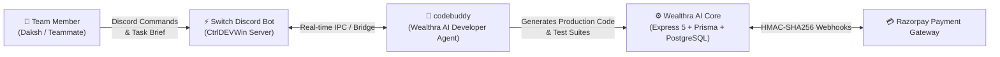
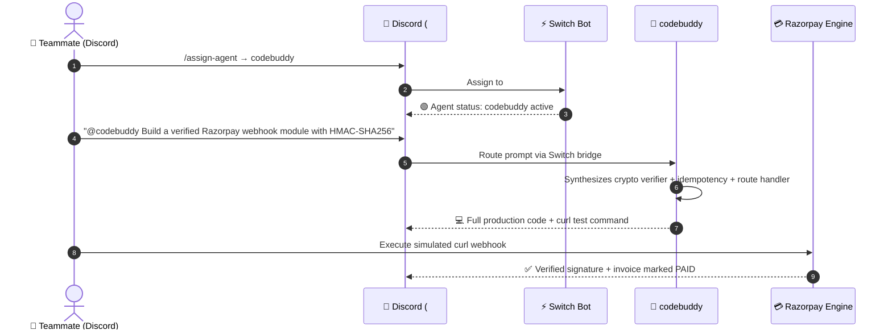

# ⚡ Switch Integration Guide — Wealthra AI (CtrlDEVWin)

> Built for the **Flip the Switch Hackathon** (Powered by Switch AI, WeMakeDevs & DevTools Academy)  
> Contributor / Switch Integration Lead: **Daksh Samberwal** (`dakshsamberwal19`)  
> Repository: [Wealthra-ai](https://github.com/aryan24cse109-dev/Wealthra-ai) · Live App: [wealthra-ai.vercel.app](https://wealthra-ai.vercel.app/) · Video Demo: [youtu.be/mG45OiztM1I](https://youtu.be/mG45OiztM1I)

---

## 💡 Overview

In **Wealthra AI**, our team integrated **Switch** to turn solo AI capabilities into an active, collaborative developer sitting directly inside our Discord server (**`CtrlDEVWin`**). 

Through the Switch Discord bot, our team assigns and interacts with **`codebuddy`** in `#general` to perform mission-critical developer workflows on demand — from generating production-grade cryptographic webhook handlers to validating payment idempotency and test scripts.

---

## 🤖 1. Connected Agent: `codebuddy`

Through Switch, we connected our core coding & operations agent:



### Agent Profile:
- **Agent Name:** `codebuddy`
- **Assigned Room:** `#general` on server `CtrlDEVWin`
- **Core Functionality Demonstrated in Video:**
  - Writing production-grade Express 5 route handlers with HMAC-SHA256 cryptographic signature validation.
  - Implementing idempotent payment status transitions (`PAID`) against duplicate webhook delivery.
  - Generating executable `curl` test commands to verify live integration without manual mocking.

---

## 💬 2. Channel & Discord Setup

Switch maps communication streams so that `codebuddy` functions like a developer teammate inside Discord:



### Discord Setup:
- **Server:** `CtrlDEVWin`
- **Room:** `#general`
- **Switch Slash Commands Used:**
  - `/assign-agent` — Assigns `codebuddy` to the current text channel.
  - `/agents-status` — Verifies that `codebuddy` is live (🟢).

---

## 🚀 3. How to Call, Use, and Test `codebuddy`

### Step 1: Assign `codebuddy` in Discord
1. Open Discord → Navigate to server **`CtrlDEVWin`** → channel **`#general`**.
2. Type `/assign-agent` and select **`codebuddy`**.
3. Confirm with `/agents-status`:
   ```
   Agent status in this room: - 🟢 codebuddy
   ```

---

### Step 2: The Core Hackathon Prompt (Option 1)
Paste this prompt in `#general`:

```text
@codebuddy We need a verified Razorpay webhook integration module for Wealthra AI.

Please write a production-ready Node.js Express route handler that:
1. Validates the incoming Razorpay webhook signature using crypto HMAC-SHA256 with RAZORPAY_WEBHOOK_SECRET.
2. Extracts event 'payment.captured', parses the invoice ID from notes, and updates invoice status to PAID.
3. Implements strict idempotency checking so duplicate webhook retries don't double-charge.
4. Provide a sample curl test command to simulate a successful payment event.
```

---

### Step 3: What `codebuddy` Delivers
Within seconds, `codebuddy` outputs:
1. **`crypto.createHmac('sha256', secret)` verification logic** to protect against spoofed transactions.
2. **Prisma database update query** targeting the verified invoice.
3. **Idempotency guard** to reject already-processed webhook events.
4. **Copy-pasteable `curl` test command** with dummy payload and signature headers.

---

## 🔗 Live Deployments

| Component | Target / Environment | Live URL | Health / Wake-up Endpoint |
|---|---|---|---|
| 🌐 **Frontend** | Vercel Production | [wealthra-ai.vercel.app](https://wealthra-ai.vercel.app/) | — |
| ⚙️ **Backend API** | Render (Free Tier) | [bizpilot-ai-1-o2e5.onrender.com](https://bizpilot-ai-1-o2e5.onrender.com) | [GET /api/health](https://bizpilot-ai-1-o2e5.onrender.com/api/health) |
| 🤖 **AI Microservice** | Render (Free Tier) | [bizpilot-ai-cx0e5.onrender.com](https://bizpilot-ai-cx0e5.onrender.com) | [GET /api/health](https://bizpilot-ai-cx0e5.onrender.com/api/health) |
| 🎥 **Video Walkthrough** | YouTube | [Watch Demo](https://youtu.be/mG45OiztM1I) | — |

---

## ©️ Submission Information
- **Hackathon:** Flip the Switch Hackathon (Switch AI × WeMakeDevs × DevTools Academy)
- **Role:** Switch Integration Lead
- **Team:** Wealthra AI
