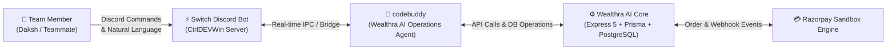
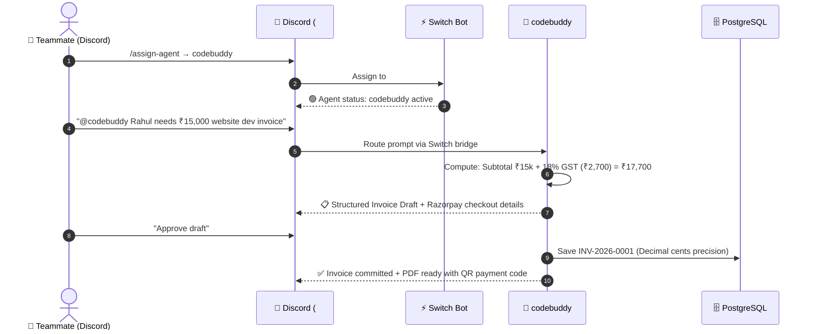

# ⚡ Switch Integration Guide — Wealthra AI (CtrlDEVWin)

> Built for the **Flip the Switch Hackathon** (Powered by Switch AI, WeMakeDevs & DevTools Academy)  
> Contributor / Switch Integration Lead: **Daksh Samberwal** (`dakshsamberwal19`)  
> Repository: [Wealthra-ai](https://github.com/aryan24cse109-dev/Wealthra-ai) · Live App: [wealthra-ai.vercel.app](https://wealthra-ai.vercel.app/) · Video Demo: [youtu.be/mG45OiztM1I](https://youtu.be/mG45OiztM1I)

---

## 💡 Overview

In **Wealthra AI**, our team integrated **Switch** to bridge team communication with backend execution. Through the Switch Discord bot on our team server (**`CtrlDEVWin`**), human teammates can assign and collaborate with our autonomous agent — **`codebuddy`** — directly inside the chat room.

Instead of manually logging into multiple dashboards to draft invoices, perform tax calculations, and verify payment webhooks, any team member can summon `codebuddy` inside `#general` to perform real, end-to-end business operations.

---

## 🤖 1. Connected Agent: `codebuddy`

Through Switch, we connected our core autonomous agent:



### Agent Profile:
- **Agent Identifier:** `codebuddy`
- **Assigned Room:** `#general` on server `CtrlDEVWin`
- **Capabilities:**
  - Automated 18% GST calculation and decimal monetary precision (`decimal.js`).
  - Invoice draft preparation and sequential numbering (`INV-2026-XXXX`).
  - Client details extraction and validation via Zod schemas.
  - Razorpay payment order monitoring & HMAC-SHA256 signature verification guidance.

---

## 💬 2. Channel & Discord Setup

Switch maps communication streams so that `codebuddy` functions like a team member inside Discord:



### Channel Details:
- **Server:** `CtrlDEVWin`
- **Room:** `#general`
- **Switch Slash Commands:**
  - `/agents-status` — Checks live status of connected Switch agents.
  - `/assign-agent` — Assigns `codebuddy` to the current text channel.

---

## 🚀 3. How to Run & Replicate the Setup

### Prerequisites
1. Discord Account & access to server `CtrlDEVWin`.
2. Switch Desktop App / CLI installed and authenticated with your Switch token.
3. Node.js 20+ and repository cloned locally.

### Step 1: Start the Local Agent Daemon
```bash
# In your terminal, initialize the Switch agent
switch agent start --name codebuddy
```

### Step 2: Assign `codebuddy` to Discord
1. Open Discord → go to server **`CtrlDEVWin`** → channel **`#general`**.
2. Type `/assign-agent` and select **`codebuddy`**.
3. Verify status by running:
   ```
   /agents-status
   ```
   You will see: `Agent status in this room: - 🟢 codebuddy`.

### Step 3: Call & Use `codebuddy`
Mention `@codebuddy` or send a natural language business operations prompt directly in `#general`:

```text
@codebuddy A client named Rahul has requested website development services worth ₹15,000. 

Please execute the following:
1. Extract client and service details.
2. Calculate 18% GST and prepare the invoice draft (Subtotal, GST, Total).
3. Confirm the sequential numbering (INV-2026-0001) and explain the Razorpay Sandbox payment simulation steps.
```

`codebuddy` will process the instruction, calculate the exact financial figures, and return the structured invoice blueprint right in the Discord thread!

---

## 🔗 Live Deployments

| Component | URL | Health Check / Status |
|---|---|---|
| 🌐 **Frontend** | [wealthra-ai.vercel.app](https://wealthra-ai.vercel.app/) | Live Production |
| ⚙️ **Backend API** | [bizpilot-ai-1-o2e5.onrender.com](https://bizpilot-ai-1-o2e5.onrender.com) | [GET /api/health](https://bizpilot-ai-1-o2e5.onrender.com/api/health) |
| 🤖 **AI Microservice** | [bizpilot-ai-cx0e5.onrender.com](https://bizpilot-ai-cx0e5.onrender.com) | [GET /api/health](https://bizpilot-ai-cx0e5.onrender.com/api/health) |
| 🎥 **Video Demo** | [Watch YouTube Walkthrough](https://youtu.be/mG45OiztM1I) | Full Demonstration |

---

## ©️ Submission Information
- **Hackathon:** Flip the Switch Hackathon (Switch AI × WeMakeDevs × DevTools Academy)
- **Role:** Switch Integration Lead
- **Team:** Wealthra AI
