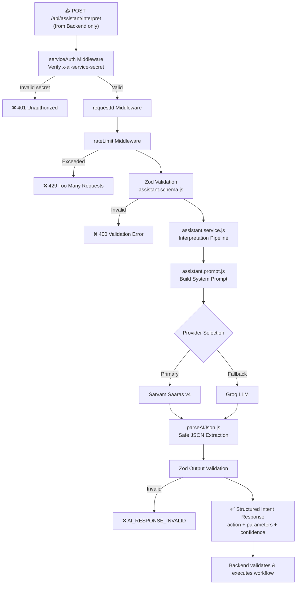
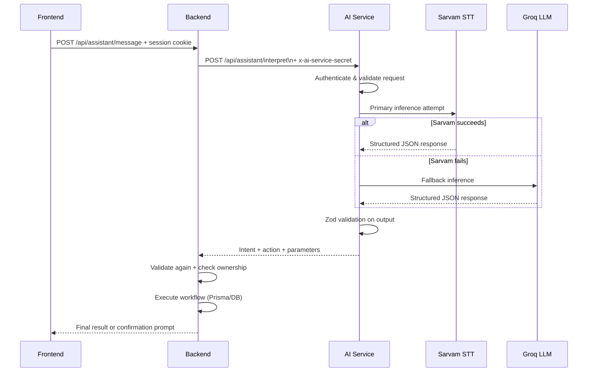

# 🤖 BizPilot AI — AI Service

> **Node.js + Express 5 · Sarvam Saaras v4 STT · Groq LLM · Multilingual NLP** · Built by **Wealthra AI**

BizPilot AI is an AI-powered business management platform for freelancers, startups, and agencies. The AI Service is a dedicated microservice responsible for natural-language understanding, speech-to-text transcription, and structured intent parsing — powering the multilingual AI assistant that understands English, Hindi, and Hinglish commands like *"Rahul ke liye 15000 rupees ka invoice banao"*.

---

## 🔗 Live Links

| Service | URL |
|---|---|
| 🤖 **AI Service (Live)** | [https://bizpilot-ai-service.onrender.com](https://bizpilot-ai-service.onrender.com) |
| 🔧 **Backend API** | [https://bizpilot-ai-backend.onrender.com](https://bizpilot-ai-backend.onrender.com) |
| 🌐 **Frontend** | [https://biz-pilot-ai.onrender.com](https://biz-pilot-ai.onrender.com) |
| 🎥 **YouTube Demo** | [Watch Full Project Demo](https://youtu.be/mG45OiztM1I) |
| 💻 **GitHub** | [github.com/aryan24cse109-dev/BizPilot-AI](https://github.com/aryan24cse109-dev/BizPilot-AI) |

> [!CAUTION]
> **⚠️ Render Free Tier — Cold Start Warning**
> This project is deployed on **Render's free tier**, which **spins down after 15 minutes of inactivity**. If the AI assistant is slow to respond on first use, **click the AI Service link above** to wake it. First cold start takes ~30–60 seconds. Subsequent requests are fast.

---

## 🛠️ Tech Stack

| Technology | Version | Purpose |
|---|---|---|
| Node.js | LTS | JavaScript runtime |
| Express | 5.3.0 | HTTP framework (ES modules) |
| Zod | 4.6.7 | Request/response schema validation |
| Helmet | 8.3.0 | HTTP security headers |
| Express Rate Limit | 8.7.3 | Abuse protection |
| Sarvam Saaras v4 | API | Speech-to-text (Hindi/English/Hinglish) |
| Groq | API | LLM inference (fallback provider) |
| Nodemon | 3.1.14 | Dev auto-reload |

---

## 📁 Folder Structure

```
ai-service/
├── src/
│   ├── app.js                          # Express app setup
│   ├── server.js                       # HTTP server entry point
│   │
│   ├── config/
│   │   ├── env.js                      # Environment variable validation
│   │   ├── ai.config.js                # AI behavior config (timeouts, retries)
│   │   └── provider.config.js          # Provider selection & fallback config
│   │
│   ├── middleware/
│   │   ├── serviceAuth.middleware.js   # x-ai-service-secret verification
│   │   ├── validate.middleware.js      # Zod request body validation
│   │   ├── rateLimit.middleware.js     # Per-route rate limiting
│   │   ├── requestId.middleware.js     # Unique request ID injection
│   │   └── error.middleware.js        # Centralized error handler
│   │
│   ├── modules/
│   │   ├── assistant/
│   │   │   ├── assistant.controller.js # POST /api/assistant/interpret
│   │   │   ├── assistant.routes.js
│   │   │   ├── analyzers/              # Intent classification logic
│   │   │   ├── output/                 # Structured response formatters
│   │   │   └── workflow/               # Multi-step workflow state machine
│   │   │
│   │   ├── voice/
│   │   │   ├── voice.controller.js     # POST /api/voice/transcribe
│   │   │   ├── voice.routes.js
│   │   │   └── voice.service.js        # Sarvam STT integration
│   │   │
│   │   └── health/
│   │       ├── health.controller.js    # GET /api/health
│   │       └── health.routes.js
│   │
│   ├── providers/
│   │   ├── groq/
│   │   │   ├── groq.config.js          # Groq client configuration
│   │   │   └── groq.provider.js        # Groq API wrapper
│   │   └── sarvam/
│   │       ├── sarvam.config.js        # Sarvam API configuration
│   │       └── sarvam.provider.js      # Sarvam STT/NLP wrapper
│   │
│   ├── prompts/
│   │   └── assistant.prompt.js         # System prompts & few-shot examples
│   │
│   ├── schemas/
│   │   └── assistant.schema.js         # Zod schemas for API contracts
│   │
│   ├── services/
│   │   ├── ai.service.js               # Provider orchestration & fallback
│   │   └── assistant.service.js        # Core interpretation pipeline
│   │
│   └── utils/
│       ├── ApiError.js                 # Standardized error class
│       ├── ApiResponse.js              # Standardized response wrapper
│       ├── constants.js                # Shared constants
│       ├── logger.js                   # Structured logger
│       └── parseAIJson.js              # Safe JSON extraction from LLM output
│
└── tests/
```

---

## 🧠 AI Pipeline Flowchart



---

## 🗣️ Voice Processing Flowchart


---

## 🌐 API Endpoints

| Method | Endpoint | Auth | Description |
|---|---|---|---|
| GET | `/api/health` | None | Service health check |
| POST | `/api/assistant/interpret` | Service secret | Interpret user message → structured action |
| POST | `/api/voice/transcribe` | Service secret | Audio → text transcription |

> [!IMPORTANT]
> The AI service is **not public**. All endpoints (except `/api/health`) require the `x-ai-service-secret` header. Only the backend should call this service directly.

---

## 🔄 Backend ↔ AI Service Communication



---

## 🎯 Supported AI Intents

| Intent | Example Command | Language |
|---|---|---|
| `CREATE_INVOICE` | "Create invoice for Rahul for ₹15,000" | English |
| `CREATE_INVOICE` | "Rahul ke liye 15000 ka invoice banao" | Hinglish |
| `GET_INVOICE_STATUS` | "What's the status of INV-2024-0023?" | English |
| `LIST_INVOICES` | "Show me all pending invoices" | English |
| `GET_DASHBOARD_STATS` | "What's my revenue this month?" | English |
| `GET_CLIENT_INFO` | "Show details for Priya Sharma" | English |
| `CLARIFICATION` | Ambiguous request | Any |

---

## 🛡️ Security Model

| Security Layer | Implementation |
|---|---|
| Service Authentication | Constant-time secret comparison |
| Rate Limiting | Per-route express-rate-limit |
| Input Validation | Zod schemas on all requests |
| Output Validation | Zod schemas on all AI responses |
| No DB Access | AI service has zero Prisma/PostgreSQL access |
| Error Sanitization | No keys, secrets, or tokens in error responses |

---

## 🚀 Local Setup

```bash
cd ai-service
npm install
cp .env.example .env

# .env required keys:
# AI_SERVICE_SECRET=your-shared-secret   (match backend INTERNAL_SERVICE_SECRET)
# SARVAM_API_KEY=your-sarvam-key
# GROQ_API_KEY=your-groq-key
# PORT=5001

npm run dev              # http://localhost:5001
```

### Health Check
```bash
curl http://localhost:5001/api/health
```

### Available Scripts
| Script | Command | Description |
|---|---|---|
| Dev Server | `npm run dev` | Nodemon auto-reload |
| Production | `npm start` | Node server |
| Syntax Check | `npm run check` | Node --check |
| Tests | `npm test` | Run test suite |

---

## 🔧 Environment Variables

| Variable | Required | Description |
|---|---|---|
| `AI_SERVICE_SECRET` | ✅ | Shared secret with backend |
| `SARVAM_API_KEY` | ✅ | Sarvam Saaras v4 STT key |
| `GROQ_API_KEY` | ✅ | Groq LLM API key |
| `PORT` | Optional | Service port (default: 5001) |
| `AI_REQUEST_TIMEOUT_MS` | Optional | Provider timeout (default: 30000) |
| `AI_MAX_RETRIES` | Optional | Retry count (default: 1) |

---

## ©️ Ownership

> All rights reserved. This project is owned by **Wealthra AI**.
