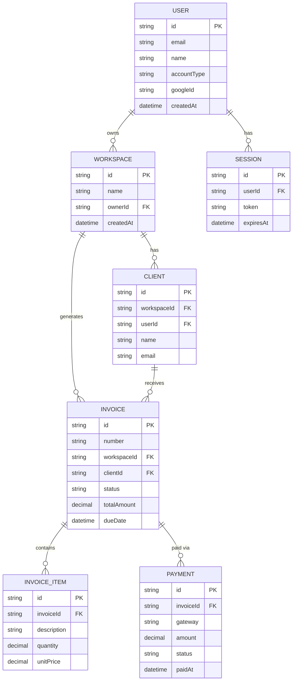
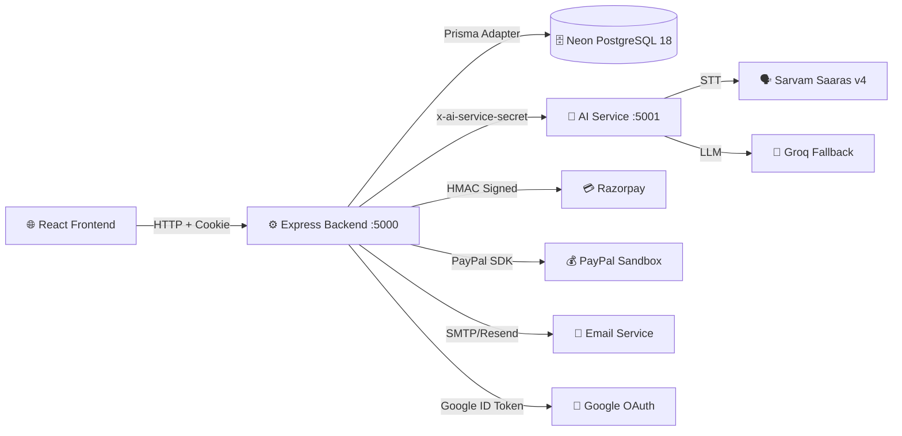
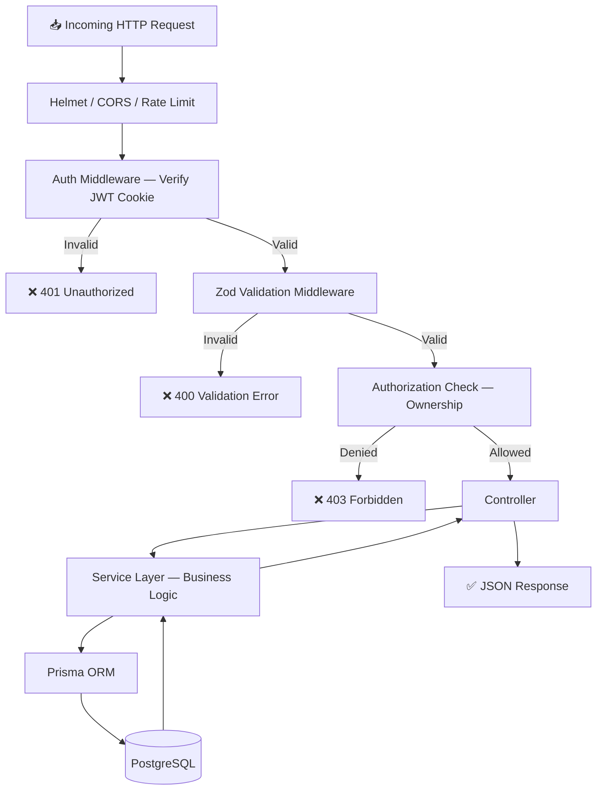
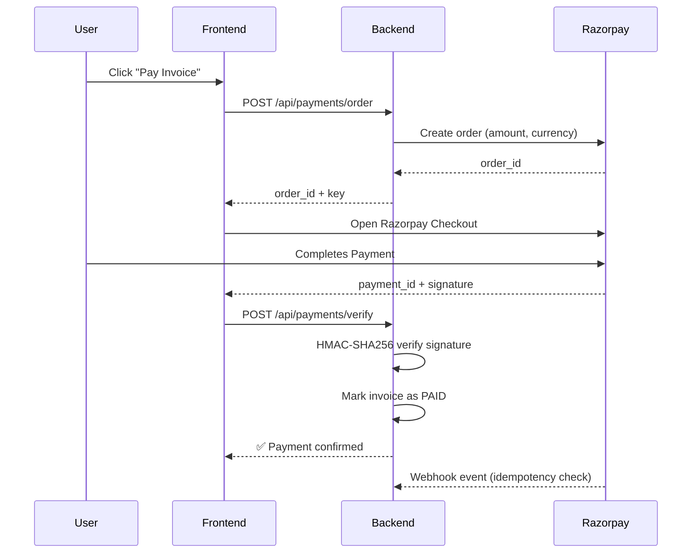

# ⚙️ BizPilot AI — Backend

> **Node.js + Express 5 + Prisma + PostgreSQL** · REST API · Built by **DEVRATOR**

BizPilot AI is an AI-powered business management platform that enables freelancers, startups, and agencies to manage invoicing, payments, client collaboration, and financial reporting — with a multilingual AI assistant that understands English, Hindi, and Hinglish. The backend is the authoritative service for all business logic, database operations, payment processing, and AI workflow execution.

---

## 🔗 Live Links

| Service | URL |
|---|---|
| 🔧 **Backend API (Live)** | [https://bizpilot-ai-backend.onrender.com](https://bizpilot-ai-backend.onrender.com) |
| 🌐 **Frontend** | [https://biz-pilot-ai.onrender.com](https://biz-pilot-ai.onrender.com) |
| 🤖 **AI Service** | [https://bizpilot-ai-service.onrender.com](https://bizpilot-ai-service.onrender.com) |
| 🎥 **YouTube Demo** | [Watch Full Project Demo](https://www.youtube.com/watch?v=YOUR_VIDEO_ID) |
| 💻 **GitHub** | [github.com/aryan24cse109-dev/BizPilot-AI](https://github.com/aryan24cse109-dev/BizPilot-AI) |

> [!CAUTION]
> **⚠️ Render Free Tier — Cold Start Warning**
> This project is deployed on **Render's free tier**, which **spins down after 15 minutes of inactivity**. If the API is unresponsive on first hit, **click the backend link above** to wake it up. First response may take ~30–60 seconds. Subsequent requests will be fast.

---

## 🛠️ Tech Stack

| Technology | Version | Purpose |
|---|---|---|
| Node.js | LTS | JavaScript runtime |
| Express | 5.3.0 | HTTP framework (ES modules) |
| Prisma | 7.9.1 | ORM & migrations |
| PostgreSQL | 18 (Neon) | Primary database |
| Zod | 4.6.7 | Request validation |
| JWT | 9.0.3 | Session tokens |
| Helmet | 8.3.0 | HTTP security headers |
| PDFKit | 0.20.2 | Invoice PDF generation |
| QRCode | 1.5.4 | Payment QR codes |
| Decimal.js | 10.6.0 | Exact monetary arithmetic |
| Razorpay | HTTP API | Payments (UPI, Card, NetBanking) |
| Google Auth Library | 11.3.3 | Google OAuth login |

---

## 📁 Folder Structure

```
backend/
├── prisma/
│   ├── schema.prisma           # Full database schema
│   └── migrations/             # Versioned DB migrations
│
├── src/
│   ├── app.js                  # Express middleware & route mounting
│   ├── server.js               # DB connection & HTTP lifecycle
│   │
│   ├── config/
│   │   ├── database.js         # Prisma client init
│   │   ├── env.js              # Environment variable validation
│   │   ├── ai.js               # AI service config
│   │   ├── email.js            # Email adapter config
│   │   ├── google.js           # Google OAuth config
│   │   └── razorpay.js         # Razorpay config
│   │
│   ├── middleware/
│   │   ├── auth.middleware.js  # JWT session verification
│   │   ├── authz.middleware.js # Role/ownership enforcement
│   │   ├── validate.middleware.js # Zod request validation
│   │   ├── rateLimit.middleware.js
│   │   └── error.middleware.js
│   │
│   ├── controllers/            # Route handlers
│   │   ├── auth.controller.js
│   │   ├── ai.controller.js
│   │   ├── invoice.controller.js
│   │   ├── payment.controller.js
│   │   ├── client.controller.js
│   │   ├── dashboard.controller.js
│   │   ├── message.controller.js
│   │   └── workspace.controller.js
│   │
│   ├── integrations/
│   │   ├── ai/                 # Backend → AI service HTTP client
│   │   │   ├── ai.client.js
│   │   │   ├── gemini.provider.js
│   │   │   └── sarvam.provider.js
│   │   ├── email/
│   │   │   ├── email.service.js
│   │   │   └── email.templates.js
│   │   ├── payments/
│   │   │   ├── adapter.js      # Payment gateway abstraction
│   │   │   ├── razorpay.adapter.js
│   │   │   └── paypal.adapter.js
│   │   └── razorpay/
│   │       ├── razorpay.service.js
│   │       ├── razorpay.signature.js
│   │       └── razorpay.webhook.js
│   │
│   ├── modules/                # Domain-driven route/service modules
│   ├── services/               # Business logic services
│   ├── routes/                 # Express router definitions
│   ├── validators/             # Zod schemas per domain
│   ├── jobs/                   # Background/scheduled jobs
│   ├── sockets/                # WebSocket handlers
│   └── utils/                  # Helpers & shared utilities
│
└── tests/
    ├── auth.test.js
    ├── invoice.test.js
    ├── payment.test.js
    └── ai.test.js
```

---

## 🗄️ Database Schema (Entity Relationship)



---

## 🏗️ System Architecture



---

## 🔀 Request Lifecycle Flowchart



---

## 📡 API Endpoints

### Authentication
| Method | Endpoint | Description |
|---|---|---|
| POST | `/api/auth/register` | Register new user |
| POST | `/api/auth/login` | Email/password login |
| POST | `/api/auth/google` | Google OAuth login |
| POST | `/api/auth/logout` | Invalidate session |
| GET | `/api/auth/me` | Current user info |
| POST | `/api/auth/forgot-password` | Password reset |

### Invoices
| Method | Endpoint | Description |
|---|---|---|
| GET | `/api/invoices` | List workspace invoices |
| POST | `/api/invoices` | Create invoice |
| GET | `/api/invoices/:id` | Invoice details |
| PATCH | `/api/invoices/:id` | Update invoice |
| DELETE | `/api/invoices/:id` | Delete invoice |
| GET | `/api/invoices/:id/pdf` | Download PDF |

### Payments
| Method | Endpoint | Description |
|---|---|---|
| POST | `/api/payments/order` | Create Razorpay order |
| POST | `/api/payments/verify` | Verify signature |
| POST | `/api/payments/webhook` | Razorpay webhook |
| GET | `/api/payments` | Payment history |

### AI Assistant
| Method | Endpoint | Description |
|---|---|---|
| POST | `/api/assistant/message` | Chat with AI (text/voice) |

### Dashboard
| Method | Endpoint | Description |
|---|---|---|
| GET | `/api/dashboard/stats` | KPI summary |
| GET | `/api/dashboard/cashflow` | Monthly collection chart data |
| GET | `/api/dashboard/aging` | Accounts receivable aging |

---

## 💳 Payment Flow



---

## 🚀 Local Setup

```bash
cd backend
npm install
cp .env.example .env     # Fill in DB, JWT, Razorpay, Google, AI keys

# Database
npx prisma generate
npx prisma migrate dev

# Start dev server
npm run dev              # http://localhost:5000
```

### Available Scripts
| Script | Command | Description |
|---|---|---|
| Dev Server | `npm run dev` | Nodemon auto-reload |
| Production | `npm start` | Node server |
| DB Migrate | `npm run db:migrate` | Run Prisma migrations |
| DB Studio | `npm run db:studio` | GUI for DB |
| Tests | `npm test` | Run all test suites |

---

## 🔐 Demo Credentials

| Role | Email | Password |
|---|---|---|
| Business Owner | `business@bizpilot.ai` | `Password@123` |
| Client | `rahul@rahulenterprises.com` | `Password@123` |

---

## ©️ Ownership

> All rights reserved. This project is owned by **DEVRATOR**.
