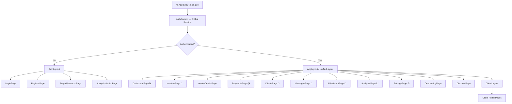
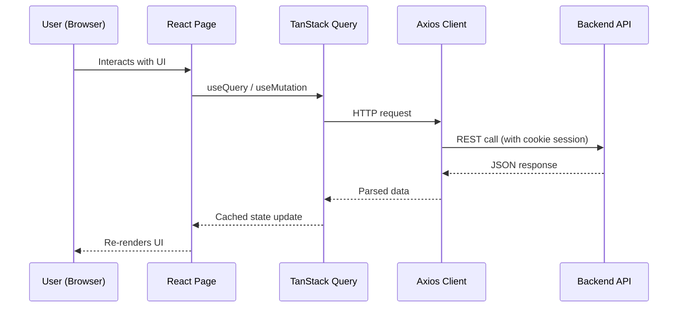

# 🚀 BizPilot AI — Frontend

> **React 18 + Vite + Tailwind CSS** · Charcoal & Emerald Fintech Theme · Built by **Wealthra AI**

BizPilot AI is an AI-powered business management platform for freelancers, startups, and small enterprises — handling invoicing, payments, client collaboration, and financial intelligence through a multilingual AI assistant. The frontend is a fast, modern SPA built with Vite, React 18, TanStack Query, and Recharts, communicating with the BizPilot backend REST API.

---

## 🔗 Live Links

| Service | URL |
|---|---|
| 🌐 **Frontend (Live)** | [https://biz-pilot-ai.onrender.com](https://biz-pilot-ai.onrender.com) |
| 🔧 **Backend API** | [https://bizpilot-ai-backend.onrender.com](https://bizpilot-ai-backend.onrender.com) |
| 🤖 **AI Service** | [https://bizpilot-ai-service.onrender.com](https://bizpilot-ai-service.onrender.com) |
| 🎥 **YouTube Demo** | [Watch Full Project Demo](https://youtu.be/mG45OiztM1I) |
| 💻 **GitHub** | [github.com/aryan24cse109-dev/BizPilot-AI](https://github.com/aryan24cse109-dev/BizPilot-AI) |

> [!CAUTION]
> **⚠️ Render Free Tier — Cold Start Warning**
> This project is deployed on **Render's free tier**, which **spins down after 15 minutes of inactivity**. If the app feels slow on first load, **click the backend/AI links above first** to wake the services up. It takes ~30–60 seconds to spin back up. Thank you for your patience!

---

## 🛠️ Tech Stack

| Technology | Version | Purpose |
|---|---|---|
| React | 18.3.1 | UI library |
| Vite | 6.0.7 | Build tool & dev server |
| Tailwind CSS | 3.4.17 | Utility-first styling |
| React Router | 7.1.1 | Client-side routing |
| TanStack Query | 5.62.8 | Server state & caching |
| Axios | 1.7.9 | HTTP client |
| React Hook Form | 7.54.2 | Form management |
| Zod | 3.24.2 | Schema validation |
| Recharts | 2.15.0 | Financial charts |
| Lucide React | 0.469.0 | Icon library |

---

## 📁 Folder Structure

```
frontend/
├── public/
├── src/
│   ├── api/                    # Axios API layer
│   │   ├── client.js           # Axios base instance + interceptors
│   │   ├── auth.api.js         # Login, register, Google OAuth
│   │   ├── ai.api.js           # AI assistant endpoints
│   │   ├── business.api.js     # Workspace/business management
│   │   ├── clients.api.js      # Client CRUD
│   │   ├── dashboard.api.js    # Analytics & KPI data
│   │   ├── invoices.api.js     # Invoice lifecycle
│   │   ├── messages.api.js     # Messaging
│   │   ├── notifications.api.js
│   │   └── payments.api.js     # Payment flows
│   │
│   ├── components/
│   │   ├── common/             # Shared UI components
│   │   └── notifications/      # Toast & notification UI
│   │
│   ├── context/
│   │   ├── AuthContext.jsx     # Global auth state
│   │   ├── NotificationContext.jsx
│   │   ├── ThemeContext.jsx    # Dark/light mode
│   │   └── ToastContext.jsx
│   │
│   ├── layouts/
│   │   ├── AppLayout.jsx       # Main authenticated shell
│   │   ├── AuthLayout.jsx      # Login/Register wrapper
│   │   ├── BusinessLayout.jsx  # Business-owner view
│   │   ├── ClientLayout.jsx    # Client portal view
│   │   └── UnifiedLayout.jsx   # Shared shell
│   │
│   ├── pages/
│   │   ├── DashboardPage.jsx   # KPI overview
│   │   ├── InvoicesPage.jsx    # Invoice list
│   │   ├── InvoiceDetailsPage.jsx
│   │   ├── PaymentsPage.jsx    # Payment tracker
│   │   ├── ClientsPage.jsx     # Client management
│   │   ├── MessagesPage.jsx    # Messaging hub
│   │   ├── AIAssistantPage.jsx # Multilingual AI chat
│   │   ├── AnalyticsPage.jsx   # Charts & reports
│   │   ├── SettingsPage.jsx    # Profile & workspace settings
│   │   ├── LoginPage.jsx
│   │   ├── RegisterPage.jsx
│   │   ├── OnboardingPage.jsx
│   │   ├── ForgotPasswordPage.jsx
│   │   ├── AcceptInvitationPage.jsx
│   │   ├── DiscoverPage.jsx
│   │   ├── DummyPaymentPage.jsx
│   │   └── client/             # Client-specific portal pages
│   │
│   ├── App.jsx                 # Route definitions
│   ├── main.jsx                # App entry point
│   └── index.css               # Tailwind base styles
│
├── index.html
├── vite.config.js
├── tailwind.config.js
└── package.json
```

---

## 🗺️ Page & Route Map



---

## 🔄 Data Flow Diagram



---

## 🎨 UI Feature Map

| Feature | Pages | Description |
|---|---|---|
| 📊 KPI Dashboard | DashboardPage | Revenue, outstanding, collection charts |
| 🧾 Invoice Engine | InvoicesPage, InvoiceDetailsPage | Create, track, download PDF invoices |
| 💳 Payment Tracking | PaymentsPage | Razorpay/PayPal payment status |
| 👥 Client Management | ClientsPage | Invite, manage, message clients |
| 🤖 AI Assistant | AIAssistantPage | Multilingual text/voice invoice creation |
| 📈 Analytics | AnalyticsPage | Aging reports, cashflow forecasts |
| 💬 Messaging | MessagesPage | Business ↔ Client communication |
| ⚙️ Settings | SettingsPage | Profile, workspace, theme config |
| 🏢 Client Portal | /client/* | Dedicated client-perspective views |

---

## 🚀 Local Setup

```bash
cd frontend
npm install
cp .env.example .env     # Set VITE_API_URL=http://localhost:5000
npm run dev              # http://localhost:5173
```

### Build for Production

```bash
npm run build
npm run preview
```

---

## 💳 Razorpay Demo Payments

This app uses **Razorpay Sandbox** — no real money is charged. Use these test credentials when the payment popup appears:

| Method | Test Value | Result |
|---|---|---|
| 💳 Card Number | `4111 1111 1111 1111` | ✅ Success |
| 📅 Expiry | Any future date (e.g. `12/26`) | — |
| 🔐 CVV | Any 3 digits (e.g. `123`) | — |
| 📱 UPI ID | `success@razorpay` | ✅ Success |
| 🏦 Net Banking | Select any bank | ✅ Success |

> [!NOTE]
> Razorpay Sandbox is fully functional — the entire payment flow (order creation → checkout → HMAC webhook verification → invoice marked PAID) runs end-to-end, just with test/simulated money.

---

## 🔐 Demo Credentials

| Role | Email | Password |
|---|---|---|
| Business Owner | `business@bizpilot.ai` | `Password@123` |
| Client | `rahul@rahulenterprises.com` | `Password@123` |

---

## ©️ Ownership

> All rights reserved. This project is owned by **Wealthra AI**.
